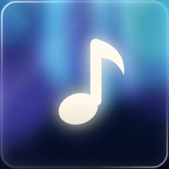
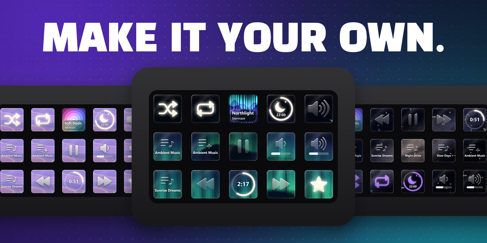
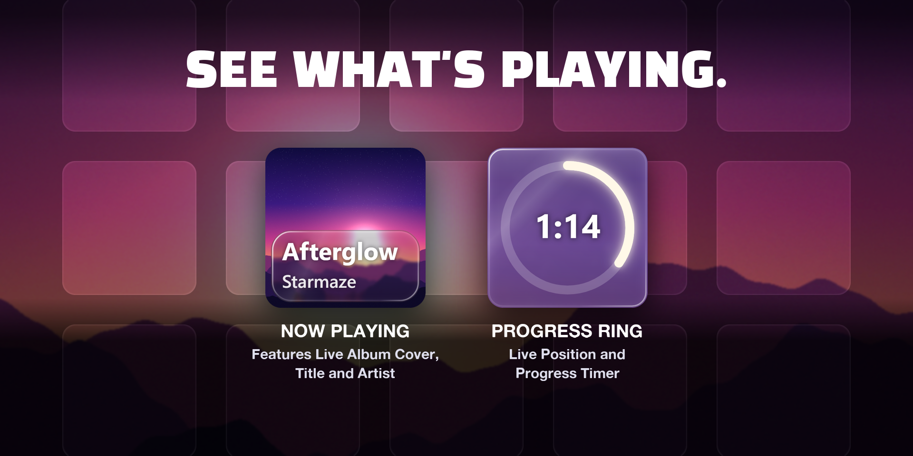
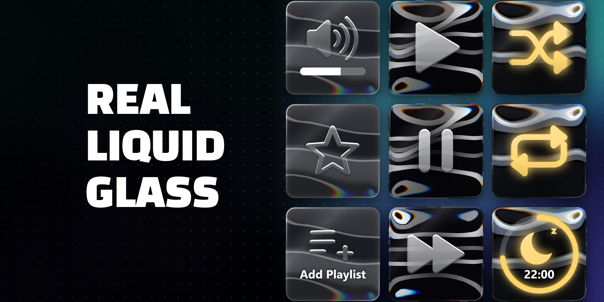
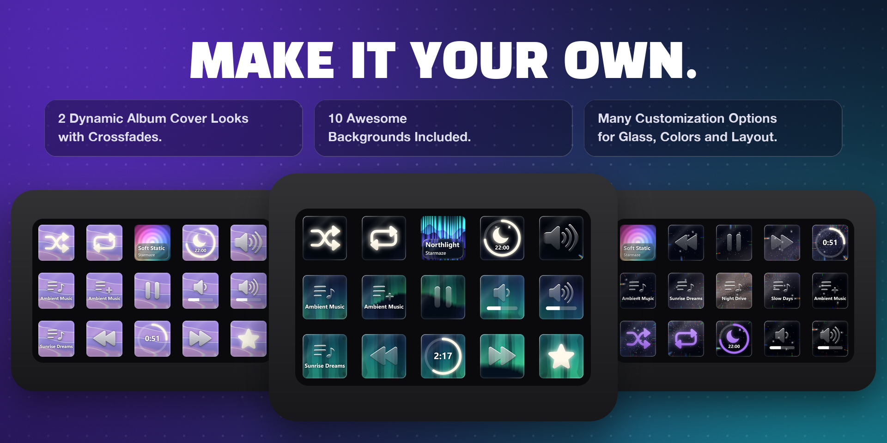
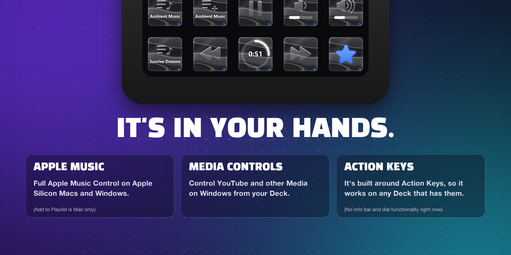

<h1 align="center">Crystal & Frosted Glass for Apple Music</h1>

<strong>Your Deck. Your Music. Your Controls.</strong>

Real liquid glass for Apple Music on your Stream Deck. Windows · Mac (Apple Silicon)

**Coming soon to the Elgato Marketplace.** The Marketplace is the only official place to get the plugin. This page is for news, screenshots, bug reports and ideas. The source code isn't public.

## See what's playing

Your album cover flows across the deck, and each new song fades in. The Now Playing key shows the title, and the big progress ring shows how far along you are.

## Real liquid glass

Every key is drawn live as glass, made to look great while you listen.

## Make it your own

2 live album looks and 10 awesome backgrounds. Pick from different glass styles, choose your colours, change the layout. It's your deck!

## Every control, one press away

- **At a glance:** The Now Playing widget shows you what's playing right now.
- **Timing is everything:** The big progress ring shows you how far along your song or (on Windows) your YouTube video is.
- **Out of the way:** Play/Pause, Skip, Back, Volume and Mute, even if Apple Music is in the background.
- **Let there be light:** Shuffle, Repeat, Mute and Favourite keys light up when active.
- **Don't get distracted:** Start your favourite playlists with one press.
- **Rest easy:** The simple sleep timer lets you fall asleep at your own pace.
- **You're the explorer:** On Mac, save a song to a playlist with one press.

## Windows and Mac

One purchase, both systems. On Windows, the keys also follow whatever is playing, so YouTube and other players get media controls, cover and progress too.

| Feature | Windows | Mac |
|---|---|---|
| Play/Pause, Next, Back | ✅ | ✅ |
| Now Playing and progress ring | ✅ | ✅ |
| Live album looks and all backgrounds | ✅ | ✅ |
| Volume and Mute | ✅ | ✅ |
| Shuffle, Repeat, Favourite | ✅ | ✅ |
| Play Playlist | ✅ | ✅ |
| Sleep Timer | ✅ | ✅ |
| Add to Playlist | — | ✅ |
| YouTube and other players | ✅ | — |

## Requirements

- Stream Deck app 7.1 or newer
- Apple Music app
- Windows 10 or 11, or a Mac with Apple Silicon (M1 or newer) on macOS 13 or newer
- Intel Macs are not supported
- Keys only: dials and the Neo info bar have no function in this version

## Help and bug reports

- **Help:** see the [support page](https://starmaze-studios.github.io/support/).
- **Found a bug or have an idea?** [Open an issue](../../issues/new/choose). Issues are public, so please leave out personal details.

**Local control. No account. No telemetry.**

Apple Music is a trademark of Apple Inc. Stream Deck and Elgato are trademarks of Corsair Memory, Inc. This plugin is an independent project and isn't affiliated with or endorsed by Apple or Elgato.
